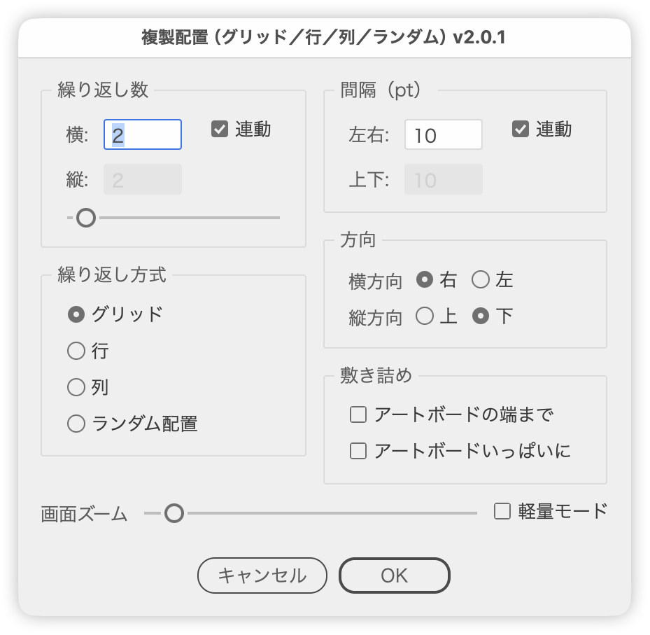

# Duplicate in a grid, row, column or at random

---

## Overview

Duplicates the selected object with a given count and spacing. Besides a grid (rows × columns) and two grids that shift every other row by half a step — Brick and Honeycomb — it can lay the copies out as a single row, a single column, or scatter them randomly: six repeat methods in all.

The dialog is laid out in two columns: Repeat Method and Count on the left, Gap, Direction, and Fill on the right. Every change refreshes a live preview, so the result can be checked before committing. The preview is drawn on a dedicated "_preview" layer and cleaned up on both OK and Cancel.

Spacing is entered in the current ruler unit (the unit set in Preferences) and converted to points internally. The fields show the active unit inside, as in "10 mm".

## Main features

- **Repeat method** (pick one)
  - Grid: rows × columns (counts are normally linked)
  - Grid (Brick): shifts the 2nd, 4th, ... rows sideways by half a step (half of width + gap), like a brick wall
  - Grid (Honeycomb): shifts every other row by half a step like Brick, and tightens the row pitch to 75% of the height plus the vertical gap so pointy-top hexagons interlock
  - Row: a single row of the horizontal count (vertical is always 1; vertical direction and vertical gap are disabled)
  - Column: a single column of the vertical count (horizontal is always 1; horizontal direction and horizontal gap are disabled)
  - Random: scattered around the center of the original object. The slider below sets the randomness (0–100%)
- **Count**: horizontal and vertical entered separately. With Link on (the link icon to the right of the fields), vertical follows horizontal. A slider (1–20) drives the same value, and preview updates are throttled while dragging to reduce flicker
- **Gap**: horizontal and vertical in the current ruler unit. With Link on, vertical follows horizontal. A slider (0 up to the larger of the original's width and height, at least the equivalent of 72 pt; Shift-drag snaps to 10s) drives it too; in the grids it works only while Link is on, and it moves the vertical gap in Column and the horizontal gap otherwise
- **Direction**: right / left and up / down (disabled depending on the repeat method)
- **Fill**
  - Fill to Artboard Edge: counts the rows and columns that fit from the selected object to the artboard edge
  - Fill Full Artboard: counts the largest grid that fits the artboard and, on OK, moves the whole set (original plus copies) to the artboard center
- **Fit to Window**: when on, zooms so the duplicates fill the given share (%) of the window
- Numeric fields step with the stepper buttons on their left or the up/down arrow keys (to the next whole number rather than by 1, e.g. 1.5 → 2; shift to the next multiple of 10; option/alt by 0.1; counts take whole numbers of 1 or more)
- Uses the clipping mask's bounds when the object is clipped, otherwise the visible bounds
- Multiple selected objects are grouped automatically before processing
- Japanese / English UI

## How to use

1. Select the object you want to duplicate.
2. Run `DuplicateInGridPlus.jsx`.
3. Choose a repeat method, then enter the count and the gap.
4. Set the direction and the Fill options as needed.
5. Check the preview and click OK.

## Repeat methods

| Method | Count | Gap | Direction |
| --- | --- | --- | --- |
| Grid | Horizontal × vertical (linkable) | Horizontal & vertical (linkable) | Right / left, up / down |
| Grid (Brick) | Horizontal × vertical (linkable) | Horizontal & vertical (linkable) | Right / left, up / down |
| Grid (Honeycomb) | Horizontal × vertical (linkable) | Horizontal & vertical (linkable) | Right / left, up / down |
| Row | Horizontal only (vertical is 1) | Horizontal only | Right / left |
| Column | Vertical only (horizontal is 1) | Vertical only | Up / down |
| Random | Horizontal only (vertical is 1) | Horizontal & vertical (always linked) | Disabled |

In Grid (Brick) and Grid (Honeycomb) the shifted rows follow the horizontal direction. The Fill counts allow for the extra half step of width and, for Honeycomb, the tighter row pitch.

In Random mode the gap value becomes the scatter range. Lowering the randomness narrows that range (0% stacks the copies on the original) while keeping the same pattern. Setting a gap to 0 turns randomness off for that axis, so the copies can be scattered on one axis only. The generated layout is cached, so pressing OK keeps exactly what the preview showed.

## Fill

| Option | Behavior |
| --- | --- |
| Fill to Artboard Edge | Counts the rows and columns that fit from the selected object's current position to the artboard edge in the chosen direction. The direction stays editable |
| Fill Full Artboard | Ignores the direction and counts the largest grid that fits the artboard. The direction radios are dimmed, and on OK the whole set is moved to the artboard center |

The two options are mutually exclusive — turning one on turns the other off. While Fill to Artboard Edge is on, choosing Left or Up as the direction turns it off automatically.

## Keyboard shortcuts

| Key | Action |
| --- | --- |
| G | Repeat method: Grid |
| R | Repeat method: Row |
| C | Repeat method: Column |
| A | Repeat method: Random |
| shift + R | Direction: Right |
| L | Direction: Left |
| T | Direction: Up |
| B | Direction: Down |

## Notes

- The preview is drawn on the "_preview" layer. If the layer does not exist it is created and brought to the front.
- Cleanup only removes the temporary items the script created (identified by a tag stored in `note`). Anything else sitting on the same layer is left alone.
- Running the script with several objects selected groups them into one group when OK is pressed, then duplicates that group. The grouping is not undone, so undo afterwards if the original structure matters. Cancelling skips the grouping entirely and leaves the document untouched.
- The gap is entered in the current ruler unit. After switching units, reopen the dialog to see the new unit.
- The count slider runs from 1 to 20. Typing into the fields accepts larger values.
- While a Fill option is on the counts are calculated automatically, so the slider is disabled — otherwise a computed count above 20 would be clamped away by the slider.
- A view changed by Fit to Window is restored on Cancel or when the dialog is closed. Confirming with OK keeps the new view.
- A large number of copies takes time to process.

## Article

[Duplicating objects in a grid with an Illustrator script (Japanese)](https://note.com/dtp_tranist/n/n228720785a71)

## Changelog

- v2.2.0 (2026-11-24) Replaced Zoom and Light mode with Fit to Window. Moved Repeat Method above Repeat Count. Added a randomness slider under Random. Added Grid (Brick) and Grid (Honeycomb) repeat methods. Added a slider to Gap
- v2.1.11 (2026-11-22) Removed the version from the window title; the script name and version now show at the bottom left (click for About This Script)
- v2.1.10 (2026-10-16) Right-only button rows are now centered when the dialog's inner width is up to 240 px (was 200 px) (shared part update)
- v2.1.9 (2026-10-04) Japanese labels now end with " :" (half-width space and colon) (shared part update)
- v2.1.8 (2026-10-03): The gap fields now show the unit inside; removed the unit from the panel title
- v2.1.7 (2026-10-01): Added space below the button row to match Illustrator's own dialogs
- v2.1.6 (2026-10-01): The button row, previously always centered, is now centered in dialogs up to 200 px wide (inside the margins) and right-aligned in wider ones. Unified the window and panel margins and spacing with the shared layout part
- v2.1.5 (2026-09-30): Dropped the script's own rightward shift of the dialog on first open
- v2.1.4 (2026-09-30): Fixed an error when running with characters selected by the Type tool
- v2.1.3 (2026-09-29): Dialog opacity changed to 98%
- v2.1.2 (2026-09-28): Keyboard shortcuts now use the shared part (ignored while Cmd etc. are held)
- v2.1.2 (2026-09-28): The button row is now built with the shared part
- v2.1.2 (2026-09-28): Clip groups are now measured by their mask (compound-path and text masks included)
- v2.1.1 (2026-09-28): Replaced the Link checkbox with a link icon
- v2.1.1 (2026-09-28): The dialog now reopens where it was last closed and moves sideways to avoid covering the selection; opacity unified at 97%
- v2.1.0 (2026-09-27): Added stepper buttons to the number fields. The arrow keys now share the steppers' logic (to the next whole number; Shift to the next multiple of ten)
- v2.0.2 (2026-08-15): Multi-selection grouping now happens after OK, so cancelling leaves the document untouched. The count slider is disabled while a Fill option is on. Fixed: returning to Grid from Row/Column/Random left Link off and the slider dead; toggling the gap Link did not recalculate the fill counts; the slider truncated its value and landed one below the drag position; preview cleanup could abort partway and leave duplicates behind; grouping stopped at the first item that refused to move; and the per-method direction states were overwritten by the Fill checkboxes. Preview updates no longer repaint twice, which reduces flicker. Switching from Column to Random now carries the count over
- v2.0.1 (2026-02-26): Repeat methods (grid / row / column / random), fill options (to artboard edge / full artboard), the count slider, and the zoom control
- (2025-10-23): Initial release
