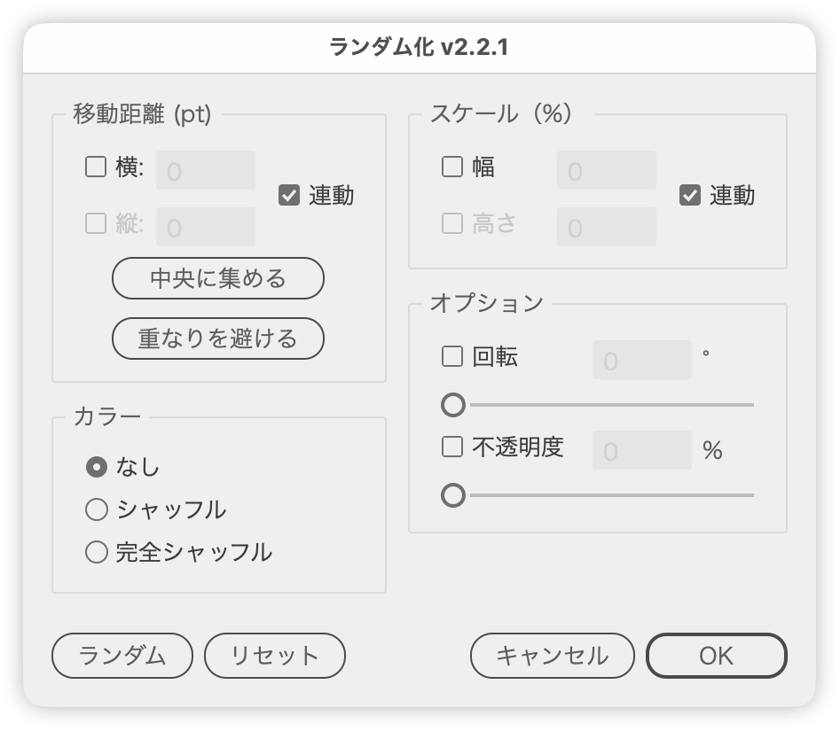

# Randomize position, scale, rotation, opacity, color and font

---

### Overview

Randomizes the position, scale, rotation, opacity, fill color, and font of the selected objects. Enter the amount of variation in the dialog to see it previewed right away, and reposition the selection with "Gather to Center" or "Avoid Overlap".

### Features

- Move distance set separately for the horizontal and vertical axes, or kept identical with the link icon (values are in pt)
- Scale (width and height) in %, also with the link icon
- Rotation (0-180 deg) and opacity (0-100%) set with a slider or by typing
- Fill color "Shuffle" (swap the colors within the selection), "Full Shuffle" (generate random colors), and "CMYK Random" (C, M or Y alone or in pairs at 30-80% each, or K alone at 20-80%)
- "Change per object" applies a random font to each text object ("Japanese only" limits the candidates to Japanese fonts)
- "Gather to Center" collects the selected objects at the center of their combined bounds
- "Avoid Overlap" repositions the objects, widening the move range until nothing overlaps
- The stepper buttons and Up/Down keys step the values (to the next whole number; Shift to the next multiple of ten; Option by 0.1)
- The preview is recomputed from the base state every time, so transforms never accumulate
- "Reset" and "Cancel" restore the state from before the dialog opened (fill colors and fonts included)
- The dialog position is remembered (until Illustrator quits)

### Flow

1. Check the document and the selection
2. Show the dialog (move distance, scale, rotation, opacity, color, font)
3. Type a value or drag a slider to preview immediately
4. Press "Random" to draw new random values (colors are applied at this point, and fonts are drawn again)
5. Commit on OK, or restore the original state on Cancel

### Notes

- Every amount means "plus or minus": a move distance of 20 pt moves each object somewhere between -20 and 20 pt.
- Rotation is capped at 180 degrees and opacity at 100%; larger values entered in the fields are pinned to those maximums.
- Turning a checkbox on fills its field with 20 (the vertical distance is the one exception and stays at 0).
- Colors are applied only when "Random" is pressed. "Shuffle" swaps the fill colors within the selection, while "Full Shuffle" generates colors that match the document color mode (K stays within 0-30 in CMYK so nothing turns too dark). "CMYK Random" fills a CMYK color whatever the document color mode. It picks one of seven ink combinations with equal odds (C, M, Y or K alone, or C+M, C+Y or M+Y) and sets only those inks, C, M and Y to 30-80% and K to 20-80%; it never mixes all three of C, M and Y, or K with anything.
- "Shuffle" needs two or more objects; "Full Shuffle" and "CMYK Random" need at least one.
- "Reset" and "Cancel" restore the fill colors too. Paths that had no fill go back to no fill, and text with mixed colors gets each character's original color back.
- Fill colors are read from and written to paths, compound paths, text frames, and groups (the first eligible object inside).
- All the text in a text object gets the same font. Turning on "Change per object" applies fonts right away, and each press of "Random" draws them again. Changing other values leaves the fonts as they are.
- Fonts apply to text objects, including each text object inside a group. Locked and hidden text is skipped, and the option is unavailable when the selection has no text.
- When the selected text contains Japanese, turning on "Change per object" also turns on "Japanese only". Japanese fonts are detected from the font name.
- "Reset" and "Cancel" restore the fonts.
- "Avoid Overlap" tries up to 300 positions per object and widens the move range up to 20x when the objects do not fit, allowing 5 pt of padding between them. The widened range is written back to the distance fields only when the placement succeeds; on failure the fields keep what you typed.
- The Live Corner Annotator is toggled while the dialog is open, since it gets in the way of the preview.

### note

https://note.com/dtp_tranist/n/nba8235fe91b2

### Change Log

- v2.1 (20260227): Full shuffle now generates random colors (K is 0-30 in CMYK), and colors are applied under Random
- v2.2 (20260305): Extracted the "avoid overlap" placement logic into a general-purpose function other scripts can reuse
- v2.2.1 (20260819): Bug fixes - rotation and scale previews now really are undone by Cancel and Reset (the old code restored a `matrix` property that PageItem does not have; the applied transforms are now undone in reverse order, and the stopgap that straightened rectangles is gone, so a rectangle you drew rotated stays rotated); the rotation field syncs to its slider again; rotation is capped at the slider maximum (180 degrees); scale [Link] reuses one random factor for width and height, so linked scaling keeps the aspect ratio; toggling distance [Link] refreshes the preview; Reset rebuilds the preview base, so a previous "Gather to Center" no longer comes back; "Avoid Overlap" keeps its placement instead of losing it on the next preview, puts the objects back when it fails, leaves the distance fields alone on failure, and writes back the range it actually used when the fields were empty; closing with the title-bar button restores the artwork and the Live Corner Annotator like Cancel does; and running the script with characters selected by the type tool no longer throws. The sliders also reset to 0 along with the fields. Housekeeping: wrapped the whole script in an IIFE, trimmed the header to an overview + README pointer, added the basic-info block (README links and the article URL), split user settings from layout constants, categorized LABELS and unified lookups on `getLabel()`, deduplicated the UI with helpers (setupPanel/setupRow/addPanel/addNumericFieldRow) and a shared builder for the distance and scale panels, split state capture / preview / panel building / dialog wiring into smaller functions, added JSDoc to every function, aligned names with the naming rules, and removed dead code
- v2.3.0 (20260927): Added stepper buttons to the number fields. The arrow keys now share the steppers' logic (to the next whole number; Shift to the next multiple of ten)
- v2.3.1 (20260928): Replaced the Link checkbox with a link icon
- v2.3.1 (20260928): The dialog now reopens where it was last closed and moves sideways to avoid covering the selection; opacity unified at 97%
- v2.3.2 (20260928): The button row is now built with the shared part
- v2.3.3 (20260929): Dialog opacity changed to 98%
- v2.3.4 (20260930): Fixed an error when running with characters selected by the Type tool
- v2.3.5 (2026-10-01): Unified the window and panel margins and spacing with the shared layout part
- v2.3.6 (2026-10-01): Added space below the button row to match Illustrator's own dialogs
- v2.3.7 (2026-10-03): Number fields now show their unit inside the field; removed the units from the panel titles and beside the fields
- v2.3.8 (2026-10-04) Japanese labels now end with " :" (half-width space and colon) (shared part update)
- v2.4.0 (2026-11-07): Added "Change per object" and "Japanese only" to apply a random font to each text object. The version moved from the title bar to small, dimmed text at the bottom left of the dialog (shared part added)
- v2.5.0 (2026-11-08): Added "CMYK Random" to Color. It fills each object at random with C, M or Y alone or two of them mixed (30-80% each), or K alone (20-80%). "Reset" and "Cancel" now restore the fill colors. The "Full Shuffle" tooltip now describes what it actually does (generates random colors)
- v2.5.1 (2026-11-08): Japanese font detection no longer counts fonts whose names start with HG
