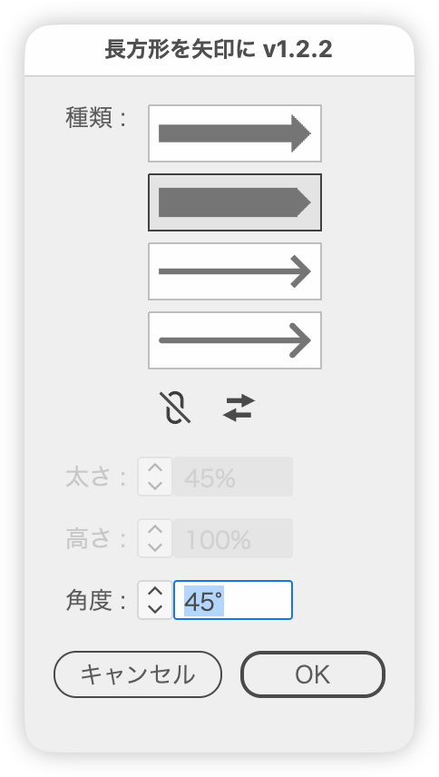

# Turn rectangles into arrows

---

### Overview

- Turns each selected rectangle or rule into an arrow that fills its bounds. Rotated rectangles and slanted rules work too.
- Choose Fill, Pentagon, Stroke (Butt Cap) or Stroke (Round Cap), and adjust the thickness, height and angle with a live preview.
- Reverse the direction or make a double-headed arrow with the icons, or by modifier-clicking a type button.

### Features

#### Type

- Pick the type with four stacked buttons that show the arrow shape. The selected one has a gray background and a darker frame
  - Fill: a single closed path. The original path is rewritten, so its effects and stacking order stay
  - Pentagon: points one end of the rectangle across its full short side. Set the tip angle with Angle. Like Fill, it rewrites the original path
  - Stroke (Butt Cap): a straight shaft and a chevron head stroked with butt caps and miter joins
  - Stroke (Round Cap): the same with round caps and round joins
- The two stroke types apply the Outline Stroke effect to each line, group the lines, and apply the Pathfinder (Add) effect to the group. They stay live, so you can still edit the stroke weight and so on
- Direction: the arrow runs along the long side (or the rule itself), pointing right when mostly horizontal and up when mostly vertical. Unrotated wide rectangles point right, tall ones up. Squares follow the more horizontal side and point up-right at 45°
  - For squares, choose Horizontal or Vertical under Direction (Horizontal by default; Vertical points up). Rectangles and rules are unaffected, and the option is dimmed when no square is selected
  - Option-click (Alt-click) a button to reverse the direction. Do it again to switch back
  - Command-Option-click (Ctrl-Alt-click) a button to toggle a double-headed arrow
  - The link (double-headed) and ⇄ (reverse) icons under the type buttons switch them too. Reverse is unavailable for double-headed arrows
  - Direction and double-headed apply to all four types. The button drawings follow the current direction

#### Thickness

- Fill: the shaft thickness as a percentage of the rectangle's short side (1–100%, starting at 45%)
- Stroke types: the stroke weight in the Stroke units set in Preferences. It starts at 15% of the first target's short side, converted to those units (or the rule's own stroke weight when the first target is a rule)
- Switching types also switches the field between % and the stroke units. Each type keeps its own value when you switch
- Use the ∧∨ buttons or the ↑↓ keys (Shift for the next multiple of 10, Option for 0.1 steps)
- Not used for Pentagon (the field is dimmed)

#### Height

- The arrow height (head width) as a percentage of the rectangle's short side (1–500%, starting at 100%). Shared by the fill and stroke types; not used for Pentagon
- The shaft thickness and stroke weight do not change. On filled arrows, the shaft is capped at the height when the height is smaller
- The head length follows the height, keeping the head right-angled

#### Angle

- The tip angle of the pentagon, measured between the axis and a slanted side (1–89°, starting at 45°). 45° gives a right-angled tip; smaller values make it sharper. Available only for Pentagon
- When the rectangle is too short for the angle, the point is capped at the full length (single) or half the length (both ends), so the tip gets blunter

#### Rules

- Besides rectangles, straight open paths (two points) are converted too. Since their short side is 0, a quarter of the line's length is used as the short side. Slanted lines get an arrow along the line
- When the first target is a rule, the dialog opens with Stroke (Butt Cap) selected

#### Shape and color

- The head is right-angled and half the height long. On short rectangles it is capped at the full length (single) or half the length (double-headed)
- Stroked arrows pull the path inward by the stroke weight so that the caps and the pointed tip stay within the rectangle. The thicker the stroke, the smaller the head
- The color comes from the rectangle's fill. When the fill is none or white, the stroke color is used; with neither fill nor stroke, black

#### Preview

- The preview is always on, from the moment the dialog opens. Copies are turned into arrows while the original rectangles are hidden; Cancel restores them

### How to use

1. Select the rectangles or rules to turn into arrows (items inside groups count; several at once is fine)
2. Run the script and set the type, thickness and height (angle for Pentagon) in the dialog
3. Click OK to replace them

### Notes

- Only rectangles (four points without handles and four right angles, rotated or not) and rules (two-point open paths without handles, slanted or not) are converted. Rounded rectangles, parallelograms, curves, and locked or hidden items are skipped
- Stroked arrows do not keep effects that were on the original rectangle
- Stroked arrows use the same stroke weight for every rectangle (the filled shaft is a percentage of each rectangle's short side)
- Stroked arrows apply their effects through menu commands on every preview update, so redrawing can slow down with many rectangles

### Article

https://note.com/dtp_tranist/n/n789072361c12

---

### Update History

- v1.3.0 (2026-10-12) Added Direction (Horizontal / Vertical) so squares can become vertical arrows. Fixed the tip and head ends of stroked arrows (butt and round cap) sticking out of the rectangle by the stroke weight
- v1.2.2 (2026-10-12) Pentagon's Angle is now the angle between the axis and a slanted side instead of the full tip angle (a right-angled tip is now 45° instead of 90°). The shapes are unchanged
- v1.2.1 (2026-10-12) Fixed squares rotated 45° pointing different ways depending on their anchor order (they now point up-right). The Pentagon button drawing is now easier to tell apart from Fill
- v1.2.0 (2026-10-12) Added the Pentagon type, with its tip angle set by Angle. Rotated rectangles and slanted or vertical rules are now supported
- v1.1.1 (2026-10-11) For horizontal rules, the dialog now starts with the stroke (butt cap) type and keeps the rule's stroke weight. Fixed stroked arrows inheriting the rule's arrowheads and width profile, overlapping anchor points at extreme heights, and missed white fills. The default stroke width and step now suit the stroke unit. Switching between the two stroke types keeps the stroke width
- v1.1.0 (2026-10-10) Added Height. Horizontal rules are now supported. The stroke types now take the thickness as a stroke weight in the Stroke units from Preferences. Added double-headed and reverse icons. A white fill now also falls back to the stroke color
- v1.0.0 (2026-10-10) Initial release

### Script info

- Version: v1.3.0
- First release: 2026-10-10
- Last updated: 2026-10-12
