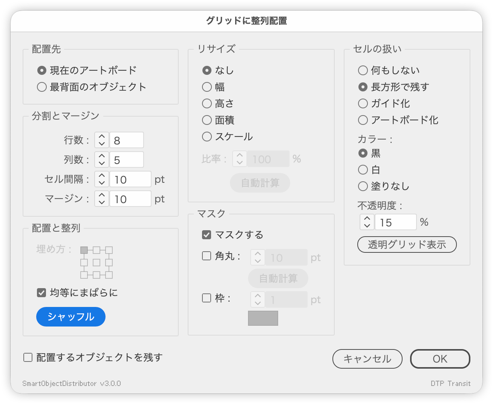

# Place objects at the center of each grid cell

---

## Overview

This script places the selected objects at the center of each cell of a grid with the given number of rows and columns.

The placement area can be the current artboard or the backmost object. Objects can be resized to the cells and clipped with masks that have round corners and a frame. Filling can start from a corner or the center, or the objects can be spread evenly over the grid. The cell rectangles can be kept, converted to guides, turned into artboards, or left out. Every setting is adjusted with a live preview.

## Main features

- Placement area switching (current artboard / backmost object)
- Rows, columns, gutter, and margin settings, plus Prioritize Gutter, which sizes the cells to the objects so the gutter becomes the gap between objects
- Initial rows and columns derived from the selection count and the area's aspect ratio, so cells stay nearly square (recalculated with the Auto icon (a magic wand) to the right of Rows and Columns, and when you switch the area or Brick)
- Resizing to the cells (Fit Width / Fit Height / Equal Area / Scale), keeping the aspect ratio, with a ratio in %. For Scale, the Auto icon next to the ratio enters a ratio at which every object covers its cell
- Clipping each object with its cell rectangle (Mask), with round corners and a frame (weight and color)
- Object Anchor to choose where each object sits in its cell (nine positions)
- Keeping the originals and placing copies in the cells (Keep Original Objects)
- Start From (any of nine positions: corners, edge centers, center), Spread Evenly to scatter objects over the grid when there are spare cells, and Brick to drop one cell from every even row and offset it by half a cell
- Cell handling: Do Nothing, Keep as Rectangles, Convert to Guides, or Convert to Artboards
- Cell fill (black, white, or no fill) and opacity
- Shuffle button to randomize the order in which objects fill the cells
- Objects beyond the number of cells are parked clear of other objects and artboards
- Transparency grid toggle, restored to its original state on exit
- Stepper buttons and arrow-key stepping (to the next whole number; Shift: to the next multiple of 10; Option: by 0.1)
- Live preview updated as values change
- Values are entered in Illustrator's ruler unit
- Japanese and English UI

## Usage

1. Select the objects to arrange in a grid.
2. Run `SmartObjectDistributor.jsx`.
3. Configure the settings in the dialog box panels.
   - Placement Area: the region the grid is laid out in
   - Divisions & Margin: rows, columns (Auto icon), gutter, margin, Prioritize Gutter
   - Placement & Arrangement: where filling starts, Spread Evenly, Brick, and Shuffle
   - Resize: how to resize and the ratio
   - Mask: whether to mask, round corners, frame
   - Cell Handling: what happens to the rectangles, color, opacity
   - Object Anchor: where each object sits in its cell
   - Keep Original Objects at the left of the button row: whether to keep the originals and place copies
4. Click Shuffle to change the assignment order if needed.
5. Adjust the values while checking the preview.
6. Click OK to apply.

## Panels and settings

| Panel | Settings |
| --- | --- |
| Placement Area | Current artboard / backmost object |
| Divisions & Margin | Rows, columns, Auto icon, gutter, margin, Prioritize Gutter |
| Placement & Arrangement | Start From (nine positions), Spread Evenly, Brick, Shuffle |
| Resize | None / Fit Width / Fit Height / Equal Area / Scale, ratio (%), Auto icon |
| Mask | Mask, Round Corners (radius, Auto icon), Frame (weight and color) |
| Cell Handling | Do Nothing / Keep as Rectangles / Convert to Guides / Convert to Artboards, color (black / white / no fill), opacity, transparency grid |
| Object Anchor | Nine positions (center by default) |
| (left of the button row) | Keep Original Objects |

## Notes

- In Resize, Fit Width and Fit Height match each object to the cell width or height times the ratio; Equal Area equalizes the areas, sized so every object fits in the cell times the ratio; Scale is relative to the original size. All keep the aspect ratio and scale stroke weights by the same factor. Objects parked beyond the cell count are not resized.
- The Auto icon next to the ratio is available with Scale. It enters the ratio at which every object in a cell is at least as wide and as tall as the cell, leaving no gap on any side, rounded up to 0.1%. Use Mask to crop what extends past the cell.
- With Mask on, each object placed in a cell is clipped with the cell rectangle (one clipping group per object). Objects parked beyond the cell count are not masked. Mask is on by default.
- Round Corners applies the Round Corners effect to each clipping group. The Auto icon next to its radius sets the radius to half the shorter side of a cell, so the short ends become semicircles. Frame adds a stroke to each mask rectangle (weight in the stroke unit; click the swatch to pick a color with the standard color picker; black by default). Both are available while Mask is on.
- Object Anchor places each object so that its anchor point meets the same point of its cell (center by default). For example, top left aligns the top-left corners; with Mask on, whatever extends past the right and bottom is cropped.
- When Start From is a corner, filling goes row by row starting at that corner. From the top or bottom center, it fills row by row from that edge, each row from the middle column outward. From the left or right center, it fills column by column from that edge, each column from the middle row outward. Center fills the cells nearest the middle first.
- With Spread Evenly on and fewer objects than cells, the cells are picked starting from the start cell, each one as far as possible from those already picked, so the objects spread over the whole grid. Shuffle re-picks among cells at the same distance. Option-click a Start From position to turn off Spread Evenly and fill from there. Spread Evenly is dimmed when there are no spare cells (as many objects as cells, or more).
- With Brick on, every even row (2nd, 4th, ...) has one cell fewer and is shifted right by half a cell, like a brick wall (for example, 4 columns × 3 rows gives 4, 3, 4 = 11 cells). It has no effect with a single column. Filling from the left or right center counts the half-shifted columns in order as well.
- With Keep Original Objects on, the originals stay where they are and only as many copies as there are cells are placed (nothing is copied or parked beyond the cell count). The placed copies are selected after OK. It is off by default.
- Click the script name and version at the bottom left of the dialog to open About This Script, which shows the script name and version, opens the README, the source code, or the article (note), and shows the script file (Show in Finder). The button to the right of the script name copies it to the clipboard.
- When Backmost Object is selected, that framing object is excluded from the objects to place.
- With Prioritize Gutter on, the cells are sized to the widest and tallest objects (after resizing) and the gutter is the gap between objects. The leftover space goes to the margin and the grid is centered in the area, so the margin is at least the value set (cells never grow beyond the size the margin and gutter allow). With it off, the margin and gutter are taken exactly and the cells get the rest.
- Objects beyond the number of cells are parked where they overlap neither other objects nor artboards.
- Any existing "cell-background" layer is hidden while the dialog is open and removed when you click OK, which clears the result of the previous run. Cancel restores its original visibility.
- Do Nothing leaves no cell rectangles (the preview shows the cells as guides).
- With Do Nothing, Convert to Guides or Convert to Artboards, the cell color is fixed to No Fill.
- Up to 100 rows and 100 columns, and up to 1000 cells. Out-of-range values are clamped when the field commits.
- Nothing is drawn when the margin or gutter leaves no room for cells, and clicking OK keeps the dialog open and explains why.
- The preview shows duplicates of the objects, and the originals are hidden only while the dialog is open. The preview is never removed with Undo, so work done before the script runs is never undone.
- Besides Cancel, pressing Esc or closing the window also discards the preview and restores the original state.
- With Keep as Rectangles, the cell rectangles are selected after clicking OK.
- Values follow Illustrator's ruler unit setting.

## Article

[Arrange objects in a grid with an Illustrator script (Japanese)](https://note.com/dtp_tranist/n/na3c45cea09b7)

## Changelog

- v3.8.0 (2026-11-20) The Auto buttons for Scale and Round Corners are now icons, placed at the right of their field rows
- v3.7.0 (2026-11-20) The Auto button for Rows and Columns is now an icon (a magic wand). Spread Evenly is available only when there are spare cells and dimmed otherwise
- v3.6.1 (2026-11-20) Renamed the Resize options to Fit Width, Fit Height, and Equal Area
- v3.6.0 (2026-11-20) Added Auto to the right of Rows and Columns. Rows and columns are also recalculated when you switch the area or Brick (Backmost Object leaves the frame object out of the count; Brick counts one cell fewer in every even row)
- v3.5.0 (2026-11-20) Moved Object Anchor out of Mask into its own panel in the right column; it now works without masking
- v3.4.0 (2026-11-20) Added Object Anchor to Mask: choose which of nine points of each object meets the same point of its cell (default: center). Panel and section spacing now match the shared UILayout part instead of being tightened
- v3.3.0 (2026-11-20) Added Brick to Placement & Arrangement (every even row has one cell fewer and is offset by half a cell)
- v3.2.0 (2026-11-20) Added Prioritize Gutter to Divisions & Margin (cells sized to the objects; the margin becomes a minimum and takes the leftover space). Option-clicking Start From turns off Spread Evenly. Tooltip wording now matches the behavior (Shuffle, Frame, rows and columns)
- v3.1.0 (2026-11-20) Renamed Fill From to Start From; it can now be any of the nine positions (edge centers added). Spread Evenly no longer dims Start From and starts spreading from the start cell
- v3.0.0 (2026-11-20) Removed the "_target" layer rectangle as a placement area. The dialog now has three columns (left: Placement Area, Divisions & Margin, Placement & Arrangement; center: Resize, Mask; right: Cell Handling), with the radio buttons and the Divisions & Margin fields stacked vertically. Split Resize & Mask into the Resize and Mask panels. Added the Placement & Arrangement panel with Fill From (top left / top right / bottom left / bottom right / center) and Spread Evenly, and moved Shuffle into it. Added Keep Original Objects (leaves the originals in place and places copies) at the left of the button row. Added Auto for Scale, and Round Corners (with Auto) and Frame for the mask, and Do Nothing for cell handling
- v2.1.0 (2026-11-20) Renamed the panel to Resize & Mask and added Mask, which clips each object with its cell rectangle. Clicking the script name and version at the bottom left opens About This Script (copy the script name, open the README, source code, or article, and show the file in the Finder)
- v2.0.0 (2026-11-12) Added the Resize panel (Width / Height / Area / Scale). The preview now uses duplicates with the originals temporarily hidden instead of Undo, fixing a bug where work done before the script could be undone. Fixed the version at the bottom of the dialog not being shown
- v1.10.8 (2026-11-05) Moved the version from the title bar to the bottom left of the dialog, small and dimmed (shared part added)
- v1.10.7 (2026-10-04) Japanese labels now end with " :" (half-width space and colon) (shared part update)
- v1.10.6 (2026-10-01): Added space below the button row to match Illustrator's own dialogs
- v1.10.5 (2026-10-01): Unified the window and panel margins and spacing with the shared layout part
- v1.10.4 (2026-09-30): Fixed an error when running with characters selected by the Type tool
- v1.10.3 (2026-09-29): Dialog opacity changed to 98%
- v1.10.2 (2026-09-28): The button row is now built with the shared part
- v1.10.1 (2026-09-28): The dialog now reopens where it was last closed and moves sideways to avoid covering the selection; opacity unified at 97%
- v1.10.0 (2026-09-27): Added stepper buttons to the number fields. The arrow keys now share the steppers' logic (to the next whole number; Shift to the next multiple of ten)
- v1.9.7 (2026-09-23): Fixed Cancel leaving the "cell-background" layer deleted (it is now removed only on OK). A "_target" rectangle that was already hidden is no longer revealed. Fixed OK closing silently when the settings cannot form a grid; the dialog now stays open and explains why. Field values are clamped on commit (no negative margins, no opacity above 100%). Fixed re-clicking the selected color radio resetting a typed opacity. The "_target" layer now prefers a rectangle and never uses open lines or paths with no area. Unit code 5 is labelled H for distances and Q for type sizes. The live preview is throttled while typing on large grids. The default division no longer exceeds the cell cap
- v1.9.6 (2026-09-19): Unified unit handling into one table covering every ruler unit (m, yd, ft, pica, and so on). Split out the layout constants and tidied naming and JSDoc
- v1.9.5 (2026-07-27): Preview rollback now uses app.undo(), so the edit history no longer grows on every change; whatever Undo cannot revert is cleaned up by restoring the centers and dropping the preview layer. Added cleanup on Esc and window close. Fixed Undo reverting the "_target" rectangle's visibility toggle instead of the preview when switching the placement area
- v1.9.0 (2026-07-27): Made the preview independent of Undo (fixes objects changing when a button is clicked repeatedly), added input validation and limits, reorganized UI wording and tooltips
- v1.8.0 (2026-04-30): Cell handling as radio buttons, placement separated from cell drawing, transparency grid state restored
- v1.0.0 (2025-06-05): Initial version
- v0.5.8 (2025-06-05): Added temporary artboard usage from the "_target" layer
- v0.5.7 (2025-06-05): Immediate preview update for margin changes
- v0.5.6 (2025-06-05): Improved UI control
- v0.5.5 (2025-06-05): Simplified grid settings, added previous cell removal
- v0.5.4 (2025-06-05): Refined UI and label structure, auto-remove cell-background layer
- v0.5.3 (2025-06-05): Unified gutter and margin settings
