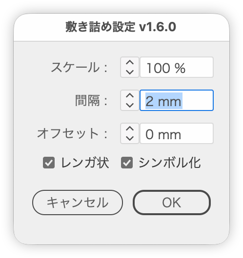

# Tile the smaller object inside the shape of the larger one

---

### Overview

With two objects selected, duplicates the smaller one in an evenly spaced grid inside the shape of the larger one.

### Features

- Only copies that fit inside the path are kept; no mask is used. Works with curves, concave shapes and holes in compound paths. Non-path objects (groups, text, etc.) use their bounding box
- Both original objects are left in place
- Spacing units follow the current ruler settings
- Scale for the placed tiles (aspect ratio kept)
- Fit inside the larger object's path offset by a set amount (negative shrinks inward, positive lets tiles stick out)
- Brick layout, and duplication as a symbol (both on by default)

### Usage

1. Select the larger object to fill and the smaller object to tile.
2. Run the script.
3. Set the scale, spacing and other options, then run it.

### Article

[Introduction article (Japanese)｜DTP Transit 別館](https://note.com/dtp_tranist/n/ne393f59cbb77)

### Update History

- v1.6.0 (2026-10-27) Added Scale. Replaced Margin with Offset (same sign as Offset Path: negative shrinks inward, positive lets tiles stick out; distance from slanted edges and curves is now measured exactly). Removed Grid count (columns and rows); tiles now always fill as much of the shape as fits. Brick pattern and Symbolize are now on by default
- v1.5.12 (2026-10-27) Renamed the script from PatternFill to TileInsideShape. Tiles that stick out of the path are now removed for any shape, not only rectangles and ellipses (previously a tile was kept when its center was inside the bounding box)
- v1.5.11 (2026-10-16) Right-only button rows are now centered when the dialog's inner width is up to 240 px (was 200 px) (shared part update)
- v1.5.10 (2026-10-04) Japanese labels now end with " :" (half-width space and colon) (shared part update)
- v1.5.9 (2026-10-03) Number fields now show the unit inside the field; removed the unit beside the fields
- v1.5.8 (2026-10-01) Added space below the button row to match Illustrator's own dialogs
- v1.5.7 (2026-10-01) Unified the window and panel margins and spacing with the shared layout part
- v1.5.6 (2026-10-01) Button rows with only right-side buttons are now centered in dialogs up to 200 px wide (inside the margins) and right-aligned in wider ones
- v1.5.5 (2026-09-30) Dropped the script's own rightward shift of the dialog on first open. Button rows with only right-side buttons are now centered
- v1.5.4 (2026-09-30) Fixed an error when running with characters selected by the Type tool
- v1.5.3 (2026-09-29) Dialog opacity changed to 98%
- v1.5.2 (2026-09-28) The button row is now built with the shared part
- v1.5.1 (2026-09-28) The dialog now reopens where it was last closed and moves sideways to avoid covering the selection; opacity unified at 97%
- v1.5.0 (2026-09-27) Added stepper buttons to the number fields. The arrow keys now share the steppers' logic (to the next whole number; Shift to the next multiple of ten)
- v1.4.2 (2026-09-19) Merged `fillinger-pattern.jsx`; added the grid count (columns and rows)
- v1.4.0 (2025-10-30)
