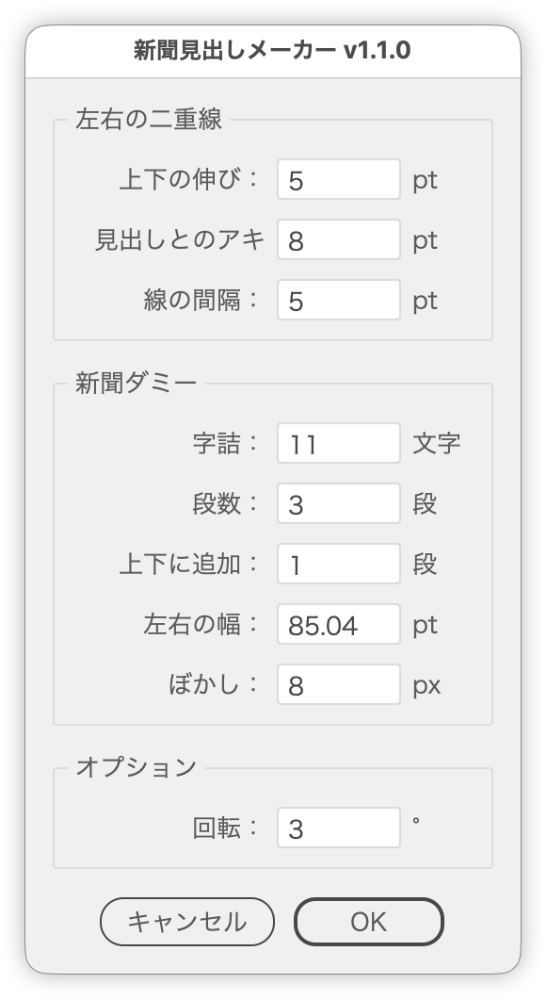

# 新聞の見出しのような画像を作る

---

### 概要

選択した見出し（テキストまたはグループ）のまわりに罫線と段組みの新聞ダミーを敷いて、新聞の紙面を切り取ったような画像を作るスクリプトです。

新聞ダミーは縦組み・横組み、和文・欧文を組み合わせて作れ、［英字新聞モード］では英字新聞らしい組み方にまとめて切り替えます。新聞ダミーにはぼかしをかけ、全体を［変形］効果で傾けて、回転しても角が欠けない長方形でマスクします。ダイアログボックスの設定はそのままプレビューに反映され、閉じずに確認できます。

### 主な機能

- 見出しの罫線：［二重］［1本（上下）］［1本（上のみ）］［なし］から選び、線幅・2本の間隔を指定。ふだんは見出しの左右に縦の線、横組みの欧文では見出しの上下に横棒で引く
- マージン：見出しから罫線までの上下・左右の距離（リンクアイコンで連動）
- 組み方向：縦組み（罫線の天地を段に分ける）と横組み（見出しの横幅を段組みに分ける、両端揃え）
- 和文／欧文：新聞ダミーの文章とフォント（ヒラギノ明朝 W3／Times New Roman）。文章は［文章...］ボタンで差し替えられる（和文・欧文それぞれ）
- 英字新聞モード：横組み・欧文に固定し、見出しの上に横棒1本、段の間に縦棒、左右の段は上下までつないだ1本の長い段
- 段数・段間（長さ）・段数追加（上下に足す段）、段間の罫線（線幅を指定）
- 字詰（1行の文字数）や段数から文字サイズを自動計算。縦組みでは上下の段と左右の段の行がそろうよう、罫線の左右の間隔を自動で微調整
- 新聞ダミーの背面に紙色の長方形（Y10 K25）
- 新聞ダミーだけにぼかし（ガウス）。見出しと罫線はくっきり残す
- 全体をグループ化し、［変形］効果で回転（中心基準）
- 回転後も角が欠けない長方形で全体をマスク。天地は罫線から見せる長さで指定（ぼかしでにじむ縁は外に出す）。OFFにもできる
- 選択した見出しに合わせて初期の選択を決める（すべて欧文なら欧文・横組み、和文の横組みなら1段、縦組みなら欧文は選べない）
- ダイアログボックスを閉じずに結果を確認できるプレビュー（原本には触らず、複製で表示）。［画面にフィット］でプレビューが収まるよう表示倍率を合わせる
- 日本語／英語UI

### 使い方

1. 見出しのテキストまたはグループを1つ選択します。
2. `ShimbunTitleMaker.jsx` を実行します。
3. 左の［マージン］［罫線］［マスクと回転］、右の［組版設定］［ダミー文章］で設定し、プレビューで確認します。
4. 「OK」をクリックして作成します。

### オプション

| パネル | 項目 | 初期値 | 内容 |
| --- | --- | --- | --- |
| マージン | 上下 | 5pt | 見出しの上端／下端から、罫線と新聞ダミーの天地を伸ばす量。横組みの欧文では見出しと横棒の距離 |
| マージン | 左右 | 8pt | 見出しと内側の線との距離（縦組みでは新聞ダミーの行をそろえるため、少し広がることがある）。横組みの欧文では横棒を見出しの左右に伸ばす量 |
| マージン | 連動 | OFF | リンクアイコンをONにすると上下と左右を同じ値にする |
| 罫線 | 種類 | 二重 | ［二重］［1本（上下）］［1本（上のみ）］［なし］。［1本（上のみ）］は見出しの上にだけ横棒を引き、横組みの欧文のときだけ選べる（それ以外に切り替えると［1本（上下）］に戻る）。［なし］でも新聞ダミーは罫線を引く場合と同じ位置に作る |
| 罫線 | 線幅 | 0.6pt | 見出しの罫線の線幅（環境設定の線の単位）。［なし］では無効 |
| 罫線 | 線の間隔 | 5pt | 内側の線と外側の線の間隔（［二重］のみ）。0なら1本だけ |
| マスクと回転 | 回転 | 3° | 全体に［変形］効果で適用する回転角度。0で効果を付けない |
| マスクと回転 | マスク | ON | 回転後も角が欠けない長方形で全体をマスクする。OFFならクリップグループを作らない。［段数追加］を0にすると自動でOFF |
| マスクと回転 | 左右 | 30mm | 左右それぞれの新聞ダミーの幅（行の整数倍に切り詰める）。マスクがOFFのときはディムになるが、新聞ダミーの幅としては使う |
| マスクと回転 | 上下 | 10mm | マスクの天地を、罫線の上端／下端からこの長さまでにする（回転後も角が欠けない大きさが上限）。マスクがOFFのときはディム |
| 組版設定 | 組み方向 | 縦組み | 縦組み（罫線の天地を段に分ける）か横組み（見出しの横幅を段組みに分ける）か。選択したテキストがすべて欧文なら横組みで始める |
| 組版設定 | 英字新聞モード | OFF | ONの間は横組み・欧文に固定し（［組み方向］［和文／欧文］はディム）、罫線を［1本（上のみ）］にする。左右の段は上下の段組みまでつないで1本の長い段にする。OFFで元の組み方向と和文／欧文に戻す。縦組みの見出しでは選べない |
| 組版設定 | 字詰 | 11文字 | 1段の1行に入れる文字数（欧文の横組みでは無効） |
| 組版設定 | 段数 | 3段 | 縦組みでは罫線の天地を分ける段数、横組みでは見出しの横幅に入る段の数（段の幅と文字サイズはこれから決まる）。値は縦組み・横組みで別々に持つ。選択したテキストが和文の横組みなら1段で始める。0で新聞ダミーを作らない |
| 組版設定 | 段間 | 3mm | 段と段の間隔。段間の罫線はこの中央に引く |
| 組版設定 | 段数追加 | 1段 | 上と下にそれぞれ足す、左右の幅いっぱいの段の数（横組みでは罫線と同じ高さの段組み） |
| 組版設定 | 段間の罫線 | ON | 段と段の間に区切り罫を引く。横組みの和文は見出しと上下の段組みの間の横罫、横組みの欧文は段と段の間の縦棒 |
| 組版設定 | 線幅 | 0.3pt | 段間の罫線の線幅（環境設定の線の単位）。［段間の罫線］がOFFのときはディム |
| 組版設定 | ぼかし | ON・8px | チェックで新聞ダミーにぼかし（ガウス）をかける。数値はその半径で、0でもかけない。option（Alt）＋Bで切り替え |
| ダミー文章 | 和文／欧文 | 和文 | 新聞ダミーの文章とフォント（ヒラギノ明朝 W3／Times New Roman）。選択したテキストがすべて欧文なら［欧文］で始める。縦組みの見出しでは［欧文］を選べない |
| ダミー文章 | 文章... | 吾輩は猫である。… | ボタンで開くダイアログボックスで、新聞ダミーに流す文章を和文・欧文それぞれ設定する。足りない分は繰り返す。空欄なら既定の文章、改行は詰める |
| ボタン行 | 画面にフィット | ON・65% | プレビューが指定の割合でウィンドウに収まるよう表示倍率を合わせる（10〜100%）。キャンセルで元の表示に戻す |

長さの欄は定規の単位、線幅の欄は線の単位を欄の中に付けて表示します（「5 mm」など。別の単位で入れた値は換算し、数値だけを入れたときは欄の単位を付けます）。数値欄は左のステップボタン（∧∨）または↑↓キーで増減できます（1ずつではなく次の整数へ（1.5→2）、Shiftで次の10の倍数へ、Optionで±0.1。字詰・段数・段数追加は整数のみ）。回転以外は負の値を受け付けません。

### 新聞ダミーの寸法

縦組みでは次のように組みます。

| 項目 | 値 |
| --- | --- |
| 1文字の送り | （罫線の天地 −（段数 − 1）× 段間）÷（段数 × 字詰） |
| 文字サイズ | 1文字の送り ÷ 垂直比率（和文85%、欧文100%） |
| 行送り | 文字サイズ × 1.4 |
| 段の間 | ［段間］。中央に区切り罫（［線幅］） |
| 罫線とのアキ | 1文字分 |
| フォント | 和文はヒラギノ明朝 W3、欧文は Times New Roman（見つからないときは既定のフォント）。欧文は字幅が狭いぶん多めに流す |

横組みでは次のように組みます。

| 項目 | 値 |
| --- | --- |
| 段の幅 | 1行の文字数 × 平均字幅（和文は［字詰］× 1em、欧文はおよそ32文字 × 0.5em） |
| 文字サイズ | 罫線の外側の線から外側の線までが「段数 × 段の幅 ＋（段数 − 1）× 段間」になる大きさ |
| 段間・罫線とのアキ | ［段間］ |
| 行送り | 文字サイズ × 1.4（和文）／1.2（欧文） |
| 上下の段組み | 罫線と同じ高さ。和文は見出しとの間に横罫（［線幅］） |
| 段と段の間（欧文） | 中央に縦の罫（［線幅］） |
| フォント | 和文はヒラギノ明朝 W3（垂直比率85%）、欧文は Times New Roman（見つからないときは Times、Georgia、既定のフォント） |

背景はどちらも Y10 K25 の長方形です。罫の色・背景色・フォント・垂直比率・行送りなどは、スクリプト冒頭の「ユーザー設定」で変更できます。RGBドキュメントでは、CMYKの値を単純換算したRGBの色を使います。

### 作成されるオブジェクト

前面から次の順に重なり、全体がクリップグループにまとまります（［マスク］がOFFのときは2のグループだけ）。

1. マスクの長方形
2. 回転（［変形］効果）をかけたグループ
   - 見出し
   - 罫線（`左右の罫線`、［なし］のときは作らない）
   - 新聞ダミー（`新聞ダミー`、ぼかしつき）
   - 背景の長方形

### 注意点

- Illustrator 2024〜2026に対応しています。
- テキストオブジェクトまたはグループを1つだけ選択して実行してください。縦組み・横組みのどちらの見出しにも使えます。
- 縦組みの見出しでは、［欧文］と［英字新聞モード］は選べません。
- 新聞ダミーの文字列は、和文は「吾輩は猫である」の冒頭、欧文は Lorem ipsum を繰り返します。和文は字詰どおりに流すため、禁則処理は「なし」にしています（句点が行頭に来ることがあります）。
- 新聞ダミーの各段には、あふれるだけの文章を流し込んでいます（あふれた分は見えません）。
- ぼかしと回転はライブエフェクトなので、あとから［アピアランス］パネルで調整できます。
- プレビュー中は選択した見出しを一時的に隠し、複製で表示します。キャンセルすると元の状態と表示に戻ります。

### 紹介記事

https://note.com/dtp_tranist/n/ndb9bee6b7a2e

### 更新履歴

- v1.5.0（2026-10-12）ダイアログボックスを［マージン］［罫線］［マスクと回転］［組版設定］［ダミー文章］のパネルに組み直した。［組み方向］（縦組み／横組み）と［英字新聞モード］を追加し、和文／欧文と組み方向を別々に選べるようにした（横組みの欧文では見出しの罫線を上下の横棒、段間の罫線を縦棒に）。罫線の種類に［1本（上のみ）］、罫線と段間の罫線に［線幅］、［段間］・マスクの［上下］・マージンの連動・［文章...］（文章の差し替え）・［段間の罫線］・［画面にフィット］・option（Alt）＋Bで［ぼかし］の切り替えを追加。［段数］と［段組数］を1つにまとめた。選択した見出しに合わせて初期の選択を決めるようにした。長さ・線幅の欄は単位を欄の中に入れ、項目名の幅を実測してそろえた。文言を見直し、内部処理を整理
- v1.4.1（2026-10-12）［ぼかし］にチェックボックスを追加し、半径を変えずにON/OFFできるようにした
- v1.4.0（2026-10-12）新聞ダミーに［和文］［欧文］を追加。欧文は見出しの横幅に入る段組数を指定して横組みの段組みで作る。ダイアログボックスを2カラムにし、新聞ダミーを右側に配置
- v1.3.7（2026-10-04）項目名のコロンを「 :」（半角スペース＋半角コロン）に変更（共通部品の更新）
- v1.3.6（2026-10-01）ボタン行の下に余白を加え、Illustrator 標準のダイアログに合わせた
- v1.3.5（2026-10-01）常に左右中央だったボタン行を、ダイアログの内側の幅（左右の余白を除く）が 200px 以内なら中央、それより広ければ右揃えに変更。ウィンドウ・パネルの余白と間隔を共通部品（UIレイアウト）にそろえた
- v1.3.4 (2026-09-30): 文字ツールで文字を選択して実行するとエラーになる不具合を修正
- v1.3.3 (2026-09-29): ダイアログの不透明度を98%に変更
- v1.3.2 (2026-09-28): ボタン行を共通の部品で組むようにした
- v1.3.1 (2026-09-28): ダイアログを前回閉じた位置で開き、選択中のオブジェクトに重なるときは左右にずらすようにした。不透明度を97%にそろえた
- v1.3.0 (2026-09-27): 数値欄にステップボタン（∧∨）を追加。↑↓キーもステップボタンと同じ処理で増減するように変更（次の整数へ、shift＋で次の10の倍数へ）
- v1.2.0 (2026-09-24): ［オプション］に［マスク］を追加（OFFでクリップグループを作らない。［上下に追加］を0にすると自動でOFF）
- v1.1.1 (2026-09-24): 新聞ダミーの文字列に句点を追加（禁則処理は「なし」）。項目名の欄を広げて「見出しとのアキ」が切れないように
- v1.1.0 (2026-09-24): 新聞ダミー（段組み・上下の段・ぼかし・背景）、回転、マスク、プレビューを追加。マージンを上下・左右の2項目に
- v1.0.0 (2026-09-23): 初期バージョン
