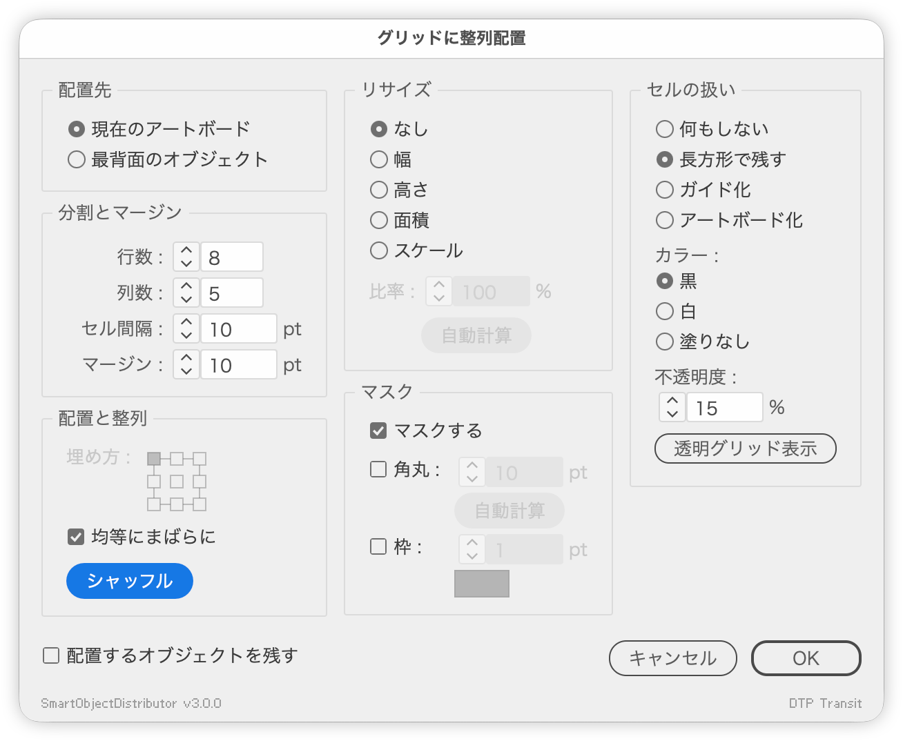

# グリッドの各セル中央にオブジェクトを配置

---

## 概要

選択したオブジェクトを、指定した行数・列数のグリッドに沿って各セルの中央へ配置するスクリプトです。

配置先は、現在のアートボードか最背面のオブジェクトから選べます。オブジェクトはセルに合わせてリサイズしたり、角丸や枠の付いたマスクで切り抜いたりできます。埋める位置は四隅や中央から選べ、グリッド全体にまばらに散らすこともできます。セルの長方形は、残す・ガイドにする・アートボードにする・何もしないから選べます。設定はすべて、プレビューを見ながら調整できます。

## 主な機能

- 配置先の切り替え（現在のアートボード／最背面のオブジェクト）
- 行数・列数・セル間隔・マージンの指定と、セルをオブジェクトの大きさに合わせてセル間隔をオブジェクトどうしのアキにする［セル間隔を優先］
- 選択数と配置先の縦横比から、セルが正方形に近くなる行数・列数を初期値として自動決定（行数・列数の右の自動計算のアイコン（魔法の杖）のほか、配置先・［レンガ］の切り替えでも計算し直す）
- セルに合わせたリサイズ（幅に合わせる／高さに合わせる／面積をそろえる／スケール。縦横比を保ち、比率を%で指定）。スケールは［自動計算］で、すべてのオブジェクトがセルを覆う（上下左右にアキが出ない）比率を入力
- セルの長方形でのクリッピングマスク（［マスクする］）。マスクの角丸と枠（線幅・色）
- セルの中でオブジェクトを寄せる位置の指定（［アイテムの基準位置］、9か所）
- 元のオブジェクトを残し、複製をセルに配置（［配置するオブジェクトを残す］）
- 開始位置の指定（9か所：四隅・上下左右の中央・中央）と、セルが余るときにグリッド全体へ散らす［均等にまばらに］、偶数行を1つ減らして半セルずらす［レンガ］
- セルの扱いを選択（何もしない／長方形で残す／ガイド化／アートボード化）
- セルの塗り（黒／白／塗りなし）と不透明度の指定
- ［シャッフル］によるセルへの割り当て順のランダム化
- セル数を超えたオブジェクトを、他のオブジェクトやアートボードと重ならない位置へ退避
- 透明グリッドの表示切り替え（終了時に元の状態へ復帰）
- ステップボタン（∧∨）・上下キーによる数値の増減（次の整数へ、Shift：次の10の倍数へ、Option：0.1単位）
- 入力と同時に更新される即時プレビュー
- 数値はIllustratorの単位設定（ルーラー単位）で入力
- 日本語／英語UI

## 使い方

1. グリッドに配置したいオブジェクトを選択します。
2. `SmartObjectDistributor.jsx` を実行します。
3. ダイアログボックスのパネルで設定します。
   - ［配置先］: グリッドを敷く領域
   - ［分割とマージン］: 行数、列数（自動計算のアイコン）、セル間隔、マージン、セル間隔を優先
   - ［配置と整列］: 開始位置、均等にまばらに、レンガ、シャッフル
   - ［リサイズ］: リサイズの基準と比率
   - ［マスク］: マスクの有無、角丸、枠
   - ［セルの扱い］: 長方形の扱い、カラー、不透明度
   - ［アイテムの基準位置］: セルの中でオブジェクトを寄せる位置
   - ボタン行の左の［配置するオブジェクトを残す］: 元のオブジェクトを残して複製を配置するか
4. 必要に応じて［シャッフル］で割り当て順を入れ替えます。
5. プレビューを確認しながら数値を調整します。
6. ［OK］をクリックして確定します。

## パネルと主な設定

| パネル | 主な設定 |
| --- | --- |
| 配置先 | 現在のアートボード／最背面のオブジェクト |
| 分割とマージン | 行数、列数、自動計算のアイコン、セル間隔、マージン、セル間隔を優先 |
| 配置と整列 | 開始位置（9か所）、均等にまばらに、レンガ、シャッフル |
| リサイズ | なし／幅に合わせる／高さに合わせる／面積をそろえる／スケール、比率（%）、自動計算 |
| マスク | マスクする、角丸（半径・自動計算）、枠（線幅・色） |
| セルの扱い | 何もしない／長方形で残す／ガイド化／アートボード化、カラー（黒／白／塗りなし）、不透明度、透明グリッド表示 |
| アイテムの基準位置 | 9か所（初期値は中央） |
| （ボタン行の左） | 配置するオブジェクトを残す |

## 注意事項

- ［最背面のオブジェクト］を選んだ場合、その枠として使うオブジェクトは配置対象から除外されます。
- ［セル間隔を優先］をオンにすると、セルの大きさをオブジェクト（リサイズ後）のいちばん大きい幅・高さに合わせ、セル間隔をオブジェクトどうしのアキとして取ります。余った分はマージンに回してグリッドを配置先の中央に置くので、マージンは指定値以上になります（セルはマージン・セル間隔どおりの大きさを超えません）。オフのときは、マージンとセル間隔を指定どおりに取り、残りをセルの大きさにします。
- セル数を超えたオブジェクトは、他のオブジェクトやアートボードと重ならない位置へ退避されます。
- 既存の「cell-background」レイヤーは、ダイアログボックスを開いている間は非表示になり、［OK］を押した時点で削除されます（前回実行の結果がリセットされます）。［キャンセル］した場合は元の表示状態に戻ります。
- ［リサイズ］の［幅に合わせる］［高さに合わせる］はセルの幅・高さ×比率に、［面積をそろえる］は面積をそろえたうえで、どのオブジェクトもセル×比率に収まる大きさにします。［スケール］は元の大きさに対する比率です。どれも縦横比を保ち、線幅も同じ倍率で変わります。セル数を超えて退避したオブジェクトはリサイズしません。
- ［自動計算］は［スケール］のときに使えます。セルに入るどのオブジェクトも幅・高さの両方がセル以上になり、上下左右にアキが出ない比率を0.1%単位で切り上げて入力します。はみ出した分は［マスクする］で切り抜けます。
- ［マスクする］をオンにすると、セルに入れたオブジェクトをそれぞれセルの長方形でクリッピングマスクします（オブジェクトごとにクリップグループを作ります）。セル数を超えて退避したオブジェクトはマスクしません。［マスクする］は初期状態でオンです。
- ［角丸］は、マスクのクリップグループに効果の［角を丸くする］を掛けます。角丸の［自動計算］は、半径をセルの短い辺の半分にします（短い辺の両端が半円になります）。［枠］は、マスクの長方形に線を付けます（線幅は線の単位、色は色見本をクリックして標準のカラーピッカーで選びます。初期値は黒）。どちらも［マスクする］がオンのときに使えます。
- ［アイテムの基準位置］は、オブジェクトの基準点をセルの同じ基準点に合わせて置きます（初期値は中央）。たとえば左上にすると、オブジェクトの左上をセルの左上にそろえます。［マスクする］がオンなら、はみ出した右・下を切り抜きます。
- ［開始位置］が四隅のときは、その角の行から横方向に埋めます。上・下の中央からはその辺の行から、各行を中央の列から外へ埋めます。左・右の中央からはその辺の列から縦方向に、各列を中央の行から外へ埋めます。中央は中心に近いセルから埋めます。
- ［均等にまばらに］をオンにすると、オブジェクトがセルより少ないとき、開始位置のセルから始めて、互いにいちばん離れたセルを順に選び、グリッド全体に散らします。［シャッフル］を押すと、距離が同じセルどうしの選び方を選び直します。開始位置を option＋クリックすると、［均等にまばらに］をオフにしてその位置から詰めて埋めます。セルが余らないとき（オブジェクトの数がセル数以上）は、［均等にまばらに］はディム表示になります。
- ［レンガ］をオンにすると、偶数行（2行目・4行目…）のセルを1つ減らし、半セル右へずらしてレンガ積みにします（例：4列×3行なら 4・3・4 の11セル）。列数が1のときは効きません。左・右の中央から埋めるときは、半セルずれた列も含めて左（右）から順に埋めます。
- ［配置するオブジェクトを残す］をオンにすると、元のオブジェクトはその場に残し、セルに入る分だけ複製して配置します（セル数を超えた分は複製も退避もしません）。OK後は配置した複製が選択された状態になります。初期状態でオフです。
- ダイアログボックス左下のスクリプト名・バージョンをクリックすると［このスクリプトについて］が開き、スクリプト名・機能・バージョンの確認、README・ソースコード・紹介記事（note）を開く操作、スクリプトのファイルの表示（［Finder に表示］）ができます。スクリプト名は、右のボタンでクリップボードにコピーできます。
- ［何もしない］ではセルの長方形を残しません（プレビューではセルの範囲をガイドで示します）。
- ［何もしない］［ガイド化］［アートボード化］では、セルのカラーは［塗りなし］に固定されます。
- 行数・列数は各100まで、セル総数は1000までです。範囲外の値は入力を確定した時点で上限・下限に丸められます。
- マージンやセル間隔が大きすぎてセルが成立しない場合は何も描画されず、［OK］を押してもダイアログボックスは閉じずに理由が表示されます。
- プレビューは元のオブジェクトの複製で表示し、元のオブジェクトはダイアログボックスを開いている間だけ非表示にします。プレビューの取り消しにUndoを使わないため、スクリプト実行前の作業が取り消されることはありません。
- ［キャンセル］のほか、Escキーやウィンドウを閉じた場合もプレビューは破棄され、元の状態に戻ります。
- ［長方形で残す］では、OK後にセルの長方形が選択された状態になります。
- 数値の単位は、Illustratorのルーラー単位の設定に従います。

## 紹介記事

[【Illustrator】配置したオブジェクトをグリッド状に配置するスクリプト｜DTP Transit 別館](https://note.com/dtp_tranist/n/na3c45cea09b7)

## 更新履歴

- v3.7.0（2026-11-20）行数・列数の［自動］ボタンを自動計算のアイコン（魔法の杖）に変更。［均等にまばらに］を、セルが余るときだけ有効にし、それ以外ではディム表示に
- v3.6.1（2026-11-20）［リサイズ］のラベルを「幅に合わせる」「高さに合わせる」「面積をそろえる」に変更
- v3.6.0（2026-11-20）行数・列数の右に［自動］を追加。配置先や［レンガ］を切り替えたときも行数・列数を計算し直すように変更（［最背面のオブジェクト］では枠のオブジェクトを数えず、［レンガ］では偶数行が1つ少ない分を数える）
- v3.5.0（2026-11-20）［アイテムの基準位置］を［マスク］から右カラムの独立したパネルに移し、マスクしないときも使えるように変更
- v3.4.0（2026-11-20）［マスク］に、セルの中でオブジェクトを寄せる位置を9か所から選ぶ［アイテムの基準位置］を追加（初期値は中央）。パネル内・パネルどうしの間隔を詰めていたのをやめ、共通部品（UILayout）と同じ間隔に戻した
- v3.3.0（2026-11-20）［配置と整列］に、偶数行のセルを1つ減らして半セルずらす［レンガ］を追加
- v3.2.0（2026-11-20）［分割とマージン］に［セル間隔を優先］を追加（セルをオブジェクトの大きさに合わせ、マージンは最低限として余りを回す）。開始位置を option＋クリックすると［均等にまばらに］をオフにするように変更。ツールチップの文言を挙動に合わせて修正（シャッフル、枠、行数・列数）
- v3.1.0（2026-11-20）「埋め方」を「開始位置」に改称し、9か所すべて（上下左右の中央を追加）から選べるように変更。［均等にまばらに］のオンで開始位置をディムにするのをやめ、開始位置から散らすように変更
- v3.0.0（2026-11-20）配置先の「_target」レイヤーの長方形を廃止。ダイアログボックスを3カラムに変更（左：配置先・分割とマージン・配置と整列、中央：リサイズ・マスク、右：セルの扱い）し、ラジオボタンと［分割とマージン］の項目を縦並びに。［リサイズとマスク］を［リサイズ］と［マスク］のパネルに分割。［配置と整列］パネルを追加し、埋め方（左上／右上／左下／右下／中央）と［均等にまばらに］を追加して［シャッフル］を移動。ボタン行の左に、元のオブジェクトを残して複製を配置する［配置するオブジェクトを残す］を追加。スケールの［自動計算］、マスクの［角丸］（［自動計算］付き）［枠］、セルの扱いの［何もしない］を追加
- v2.1.0（2026-11-20）パネル名を［リサイズとマスク］に変更し、セルの長方形でクリッピングマスクする［マスクする］を追加。左下のスクリプト名・バージョンをクリックすると［このスクリプトについて］を表示（スクリプト名のコピー、README・ソースコード・記事を開く、Finder に表示）
- v2.0.0（2026-11-12）［リサイズ］パネルを追加（幅／高さ／面積／スケール）。プレビューをUndoによる取り消しから複製＋一時非表示に変更し、スクリプト実行前の作業まで取り消されることがある不具合を修正。ダイアログボックス下のバージョン表示が出ていなかった不具合を修正
- v1.10.8（2026-11-05）バージョンをタイトルバーから外し、ダイアログボックスの左下に小さく薄く表示（共通部品の追加）
- v1.10.7（2026-10-04）項目名のコロンを「 :」（半角スペース＋半角コロン）に変更（共通部品の更新）
- v1.10.6（2026-10-01）ボタン行の下に余白を加え、Illustrator 標準のダイアログに合わせた
- v1.10.5（2026-10-01）ウィンドウ・パネルの余白と間隔を共通部品（UIレイアウト）にそろえた
- v1.10.4 (2026-09-30): 文字ツールで文字を選択して実行するとエラーになる不具合を修正
- v1.10.3 (2026-09-29): ダイアログの不透明度を98%に変更
- v1.10.2 (2026-09-28): ボタン行を共通の部品で組むようにした
- v1.10.1 (2026-09-28): ダイアログを前回閉じた位置で開き、選択中のオブジェクトに重なるときは左右にずらすようにした。不透明度を97%にそろえた
- v1.10.0 (2026-09-27): 数値欄にステップボタン（∧∨）を追加。↑↓キーもステップボタンと同じ処理で増減するように変更（次の整数へ、shift＋で次の10の倍数へ）
- v1.9.7 (2026-09-23): ［キャンセル］で「cell-background」レイヤーが戻らない不具合を修正（削除は［OK］時のみ）。元から非表示だった「_target」の長方形を勝手に表示しないように変更。グリッドが成立しない設定で［OK］を押すと無言で閉じていた問題を修正し、理由を表示してダイアログを保持するように変更。入力値を確定時に上限・下限へ丸めるように変更（負のマージンや100%超の不透明度を防止）。カラーのラジオボタンを選び直しただけで不透明度が既定値に戻る不具合を修正。「_target」レイヤーでは長方形を優先し、開いた線や面積のないパスを配置先にしないように変更。級（Q）と歯（H）の呼び分けに対応。セル数が多いときの入力中プレビューを間引いて軽量化。既定の分割数がセル総数の上限を超えないように修正
- v1.9.6 (2026-09-19): 単位の扱いを共通のテーブルに統一し、m・yd・ft・picaなどルーラー単位の全種類に対応。レイアウト用の定数を分離し、命名とJSDocを整理
- v1.9.5 (2026-07-27): プレビューの巻き戻しをapp.undo()ベースに変更し、設定を変更するたびに取り消し履歴が伸び続ける問題を解消。Undoで戻りきらない分は中心座標の復元とレイヤー削除で補完。Escキーやウィンドウを閉じた場合の後始末を追加。配置先を切り替えた際に、Undoがプレビューではなく「_target」矩形の表示切り替えを取り消していた不具合を修正
- v1.9.0 (2026-07-27): プレビューをUndo非依存に変更（ボタン連打でオブジェクトが変化する不具合を修正）、入力値の検証と上限を追加、UI文言とツールチップを整理
- v1.8.0 (2026-04-30): セルの扱いをラジオボタン化、配置処理を分離、透明グリッドの状態を復元
- v1.0.0 (2025-06-05): 初期バージョン
- v0.5.8 (2025-06-05): 「_target」レイヤーの長方形を一時的な配置先として使用できるように
- v0.5.7 (2025-06-05): マージン変更時にプレビューを即時更新
- v0.5.6 (2025-06-05): UIの制御を改善
- v0.5.5 (2025-06-05): グリッド設定を簡素化、前回のセルを削除する処理を追加
- v0.5.4 (2025-06-05): UIとラベル構成を整理、cell-backgroundレイヤーの自動削除を追加
- v0.5.3 (2025-06-05): セル間隔とマージンの設定を統合
