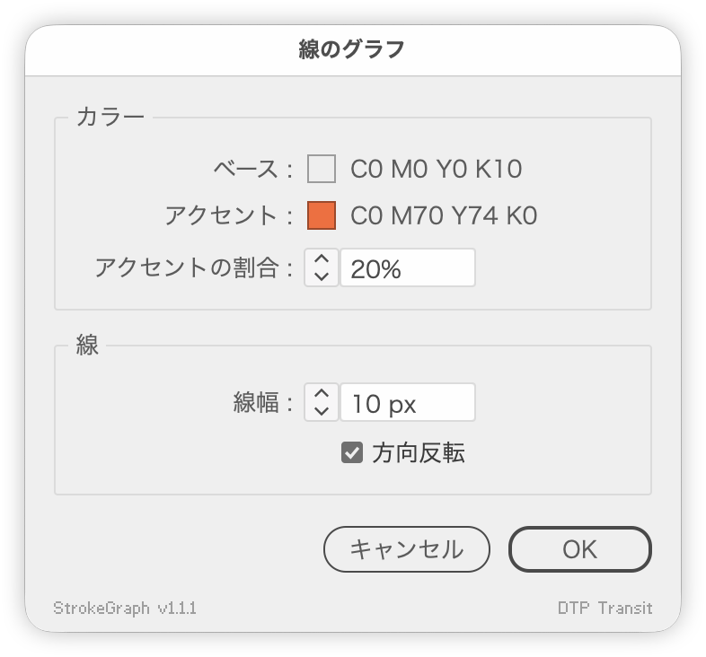

# 線を2色の破線グラフにする

---

### 概要

選択したパスの線を、ベースとアクセントの2色で塗り分けた丸型の破線にして、円グラフや進捗バーのような線のグラフを作ります。
パスの色をアクセントにし、グラデーションの無い線にも、埋め込んだグラフィックスタイルで［パスに沿ってグラデーションを適用］の線を付けます。

### 主な機能

- 選択したパス（グループ・複合パスの中も）を、線のグラフの形にそろえる
  - 塗りをなしにする
  - 線にグラデーションが無いパスには、スクリプトに埋め込んだグラフィックスタイル「stroke-gradient」を適用して、［パスに沿ってグラデーションを適用］の線にする（不透明度・描画モードはそのまま）。スタイルがドキュメントにあれば埋め込んだファイルは開かず、無いときだけ取り込む（外部ファイルは要らない）
  - 線を2色のセパレートグラデーションにする。始点側がベース、終点側から［アクセントの割合］の長さがアクセント（20% なら境界は 80%）
  - 破線（線分 1pt・間隔は空白）・丸型線端・［コーナーやパス先端に破線の先端を整列］を設定
  - パスの方向を反転する（［方向反転］がオンのとき）
  - 楕円のライブシェイプは角度を 90° にする（変形パネルの［楕円形のプロパティ］の角度。すでに 90° なら変えない）
- パスごとに専用のグラデーション（「Stroke Graph」「Stroke Graph 1」…）を作って付けるので、同じグラデーションを共有している、選択していないオブジェクトは変わらない
- ダイアログボックスで指定
  - ベース・アクセント：見本をクリックすると Illustrator 標準のカラーピッカーでカラーを変更
  - アクセントの割合：∧∨ ボタン・↑↓キー・直接入力（四則演算も可）
  - 線幅：環境設定の線の単位で表示
  - 方向反転：パスの方向を反転するか（初期値はオン。切り替えるとその場で反転し、ベースとアクセントの位置が入れ替わる）
- 入力に合わせてその場で反映（プレビューは常にオン）
- 初期値
  - 線がグラデーションでなければ、パスの色（線の色。線なしなら塗りの色、どちらも無ければ赤）をアクセント、K10 をベース、アクセントの割合を 20%、線幅を 10pt にする
  - 線がグラデーションなら（一度グラフにしたパスなど）、始点側の色をベース、終点側の色をアクセント、今の線幅を線幅にし、すでに2色に分かれていれば今の境界からアクセントの割合を出す
- ［キャンセル］では、塗り・線の設定・グラデーション・方向・楕円の角度を元に戻す

### 使い方

1. 円や楕円などのパスを選択します。
2. スクリプトを実行します。
3. カラー・アクセントの割合・線幅・［方向反転］を指定し、［OK］をクリックします。

### AI ファイルの埋め込み（エンコード版）について

StrokeGraph は、グラフィックスタイル「stroke-gradient」を収めた AI ファイル（strokegradient.ai、約110KB）を Base64 という形式で文字に変換（エンコード）して、スクリプトの末尾に埋め込んでいます。そのため、スクリプト1本だけで動きます（スクリプトは約350KB）。

- 初めて使うときは、埋め込んだデータを元の AI ファイルに戻して、一時フォルダー（Folder.temp/StrokeGraph/中身の ID/strokegradient.ai）に書き出してから開きます
- 2回目からは書き出したファイルを使い、戻す処理はしません。ドキュメントに「stroke-gradient」のスタイルがあれば、AI ファイルも開きません
- AI ファイルの中身が変わると ID も変わるので、古いファイルと取り違えません
- AI ファイルを差し替えるときは、helpers/embed-file-base64.py で埋め込み直します（`python3 helpers/embed-file-base64.py jsx/color/StrokeGraph.jsx 新しいファイル.ai`）
- AI ファイルを埋め込まず、スクリプトと同じフォルダーに置いて読み込む版は［線を2色の破線グラフにする（AI ファイル読み込み版）］（[StrokeGraphFromFile](StrokeGraphFromFile.md)）です

### 注意点

- 線のグラデーションの種類はスクリプトから設定できないため、［パスに沿ってグラデーションを適用］はグラフィックスタイルで付けます。スタイルを取り込んだドキュメントには、「stroke-gradient」のスタイルとそのグラデーションのスウォッチが残ります。もとから線がグラデーションのパスは、今の種類のまま変わりません。
- スタイルを適用するとき、不透明度・描画モードは元に戻しますが、線を複数重ねたアピアランスや効果は消えます（［キャンセル］でも戻りません）。
- 破線は線の設定のアクションで入れるため、矢印はなし、線の位置は中央になります。［キャンセル］でも［コーナーやパス先端に破線の先端を整列］はオンのまま残ります。
- 実行するたびに、パスの数だけグラデーションのスウォッチが増えます。
- 楕円の角度は楕円のライブシェイプにだけ入ります。［キャンセル］では、角度を変えた楕円を 0° に戻します（すでに 90° だった楕円はそのまま）。
- 同じパスに2回実行すると、方向の反転がもう一度かかります。元の向きのままにするときは［方向反転］をオフにしてください。
- 楕円の角度（ELLIPSE_ANGLE・ELLIPSE_ANGLE_ON_CANCEL）、アクセントの割合の初期値（DEFAULT_ACCENT_PERCENT）、ベース・アクセントの初期値（DEFAULT_BASE_COLOR・DEFAULT_ACCENT_COLOR）、線幅の初期値（DEFAULT_STROKE_WIDTH）、破線の値（STROKE_DASH_PATTERN）はスクリプト冒頭で変更できます。

### 紹介記事

https://note.com/dtp_tranist/n/ne78abaa5610e

### 更新履歴

- v1.1.1（2026-11-22）「アクセントの%」を「アクセントの割合」に改名。［方向反転］の左端を線幅の入力欄にそろえ、線幅との間にアキを入れた。カラーの値の欄を狭めてダイアログボックスの右の空きを詰めた
- v1.1.0（2026-11-21）グラデーションの無い線に、埋め込んだグラフィックスタイルで［パスに沿ってグラデーションを適用］の線を付けるようにした。パスの色をアクセント、K10 をベースの初期値にし、線幅の初期値を 10pt にした。塗りをなしにするようにした。すでに 90° の楕円は角度を変えないようにした。ダイアログボックスに［方向反転］を追加し、上の説明の行を外した。境界の2つのストップを同じ位置に置き、中間色が出ないようにした
- v1.0.1（2026-11-20）90° の回転をやめ、楕円のライブシェイプの角度を 90° にする（ダイナミックアクション）ようにした
- v1.0.0（2026-11-20）最初のリリース
