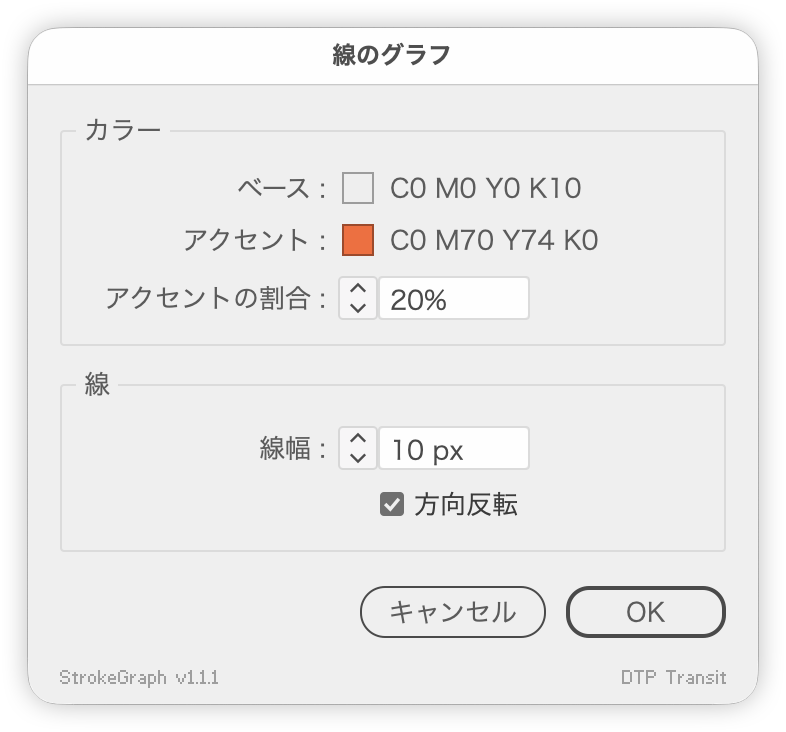

# 線を2色の破線グラフにする（AI ファイル読み込み版）

---

### 概要

選択したパスの線を、ベースとアクセントの2色で塗り分けた丸型の破線にして、円グラフや進捗バーのような線のグラフを作ります。
［線を2色の破線グラフにする］（[StrokeGraph](StrokeGraph.md)）と同じ機能で、［パスに沿ってグラデーションを適用］のグラフィックスタイルを、スクリプトに埋め込まずにスクリプトと同じフォルダーの strokegradient.ai から読み込みます。

### 主な機能

- 選択したパス（グループ・複合パスの中も）を、線のグラフの形にそろえる
  - 塗りをなしにする
  - 線にグラデーションが無いパスには、スクリプトと同じフォルダーの strokegradient.ai から読み込んだグラフィックスタイル「stroke-gradient」を適用して、［パスに沿ってグラデーションを適用］の線にする（不透明度・描画モードはそのまま）。スタイルがドキュメントにあれば strokegradient.ai は開かず、無いときだけ読み込む
  - 線を2色のセパレートグラデーションにする。始点側がベース、終点側から［アクセントの割合］の長さがアクセント（20% なら境界は 80%）
  - 破線（線分 1pt・間隔は空白）・丸型線端・［コーナーやパス先端に破線の先端を整列］を設定
  - パスの方向を反転する（［方向反転］がオンのとき）
  - 楕円のライブシェイプは角度を 90° にする（変形パネルの［楕円形のプロパティ］の角度。すでに 90° なら変えない）
- パスごとに専用のグラデーション（「Stroke Graph」「Stroke Graph 1」…）を作って付けるので、同じグラデーションを共有している、選択していないオブジェクトは変わらない
- ダイアログボックスで指定
  - ベース・アクセント：見本をクリックすると Illustrator 標準のカラーピッカーでカラーを変更
  - アクセントの割合：∧∨ ボタン・↑↓キー・直接入力（四則演算も可）
  - 線幅：環境設定の線の単位で表示
  - 方向反転：パスの方向を反転するか（初期値はオン。切り替えるとその場で反転し、ベースとアクセントの位置が入れ替わる）
- 入力に合わせてその場で反映（プレビューは常にオン）
- 初期値
  - 線がグラデーションでなければ、パスの色（線の色。線なしなら塗りの色、どちらも無ければ赤）をアクセント、K10 をベース、アクセントの割合を 20%、線幅を 10pt にする
  - 線がグラデーションなら（一度グラフにしたパスなど）、始点側の色をベース、終点側の色をアクセント、今の線幅を線幅にし、すでに2色に分かれていれば今の境界からアクセントの割合を出す
- ［キャンセル］では、塗り・線の設定・グラデーション・方向・楕円の角度を元に戻す

### 使い方

1. strokegradient.ai を、スクリプトと同じフォルダーに置きます。
2. 円や楕円などのパスを選択します。
3. スクリプトを実行します。
4. カラー・アクセントの割合・線幅・［方向反転］を指定し、［OK］をクリックします。

### 注意点

- strokegradient.ai がスクリプトと同じフォルダーに無いと、グラデーションの無い線には［パスに沿ってグラデーションを適用］を付けられません（探した場所を表示して止まります）。読み込むファイル名は STYLE_SOURCE_FILE_NAME で変更できます。
- スクリプトに AI ファイルを埋め込まないぶん、StrokeGraph よりファイルが小さくなります。ダイアログボックスの位置は StrokeGraph とは別に記憶します。
- 線のグラデーションの種類はスクリプトから設定できないため、［パスに沿ってグラデーションを適用］はグラフィックスタイルで付けます。スタイルを取り込んだドキュメントには、「stroke-gradient」のスタイルとそのグラデーションのスウォッチが残ります。もとから線がグラデーションのパスは、今の種類のまま変わりません。
- スタイルを適用するとき、不透明度・描画モードは元に戻しますが、線を複数重ねたアピアランスや効果は消えます（［キャンセル］でも戻りません）。
- 破線は線の設定のアクションで入れるため、矢印はなし、線の位置は中央になります。［キャンセル］でも［コーナーやパス先端に破線の先端を整列］はオンのまま残ります。
- 実行するたびに、パスの数だけグラデーションのスウォッチが増えます。
- 楕円の角度は楕円のライブシェイプにだけ入ります。［キャンセル］では、角度を変えた楕円を 0° に戻します（すでに 90° だった楕円はそのまま）。
- 同じパスに2回実行すると、方向の反転がもう一度かかります。元の向きのままにするときは［方向反転］をオフにしてください。
- 楕円の角度（ELLIPSE_ANGLE・ELLIPSE_ANGLE_ON_CANCEL）、アクセントの割合の初期値（DEFAULT_ACCENT_PERCENT）、ベース・アクセントの初期値（DEFAULT_BASE_COLOR・DEFAULT_ACCENT_COLOR）、線幅の初期値（DEFAULT_STROKE_WIDTH）、破線の値（STROKE_DASH_PATTERN）はスクリプト冒頭で変更できます。

### 紹介記事

https://note.com/dtp_tranist/n/ne78abaa5610e

### 更新履歴

- v1.0.0（2026-11-22）最初のリリース（StrokeGraph v1.1.1 をもとに、グラフィックスタイルを外部の AI ファイルから読み込むようにした）
