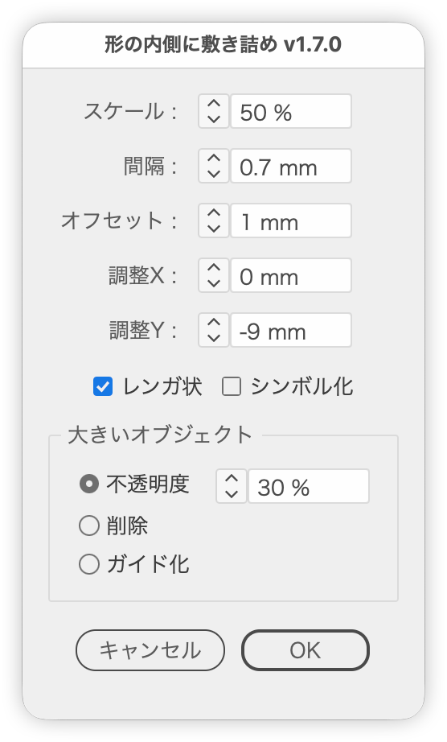

# 大きいオブジェクトの形の内側に小さいオブジェクトを敷き詰める

---

### 概要

2つのオブジェクトを選択し、小さい方を大きい方の形の内側に、等間隔の格子状に複製して敷き詰めます。

### 主な機能

- パスの内側に収まるものだけを残す（マスクは使わない）。曲線や凹んだ形、複合パスの穴にも対応。グループは構成するオブジェクトそれぞれの形の内側で判定（クリップグループはクリッピングパスの形）。テキストはアウトライン化した字形の内側で判定（複製をアウトライン化して測り、測ったあとは削除するので元のテキストは変わらない）。配置画像などそれ以外は外接矩形の内側で判定
- 元の2オブジェクトはそのまま残す。［大きいオブジェクト］で、その不透明度を下げる・削除する・ガイド化することもできる
- ［調整X］［調整Y］で、敷き詰める位置を少しずらせる（正の値で右・下へ）
- 間隔の単位はIllustratorのルーラー設定に追従
- 敷き詰めるタイルのスケール（縦横比は固定）
- 大きいオブジェクトのパスをオフセットした形に収める（負の値で内側に縮め、正の値ではみ出しを許す）
- レンガ状の配置、シンボル化しての複製（どちらも初期値はオン）
- ［OK］で確定した設定を Illustrator の終了まで覚え、次に開いたときの初期値にする

### 使い方

1. 敷き詰める先の大きいオブジェクトと、敷き詰める小さいオブジェクトを選択します。
2. スクリプトを実行します。
3. スケールや間隔などを指定して実行します。

### 紹介記事

[紹介記事｜DTP Transit 別館](https://note.com/dtp_tranist/n/ne393f59cbb77)

### 更新履歴

- v1.7.0（2026-10-27）［OK］で確定した設定（スケール・間隔・オフセット・レンガ状・シンボル化）を Illustrator の終了まで覚え、次に開いたときの初期値にするようにした。大きいオブジェクトがグループのときは、グループ全体の外接矩形ではなく、構成するオブジェクトそれぞれの形の内側に敷き詰めるようにした（クリップグループはクリッピングパスの形）。テキストのときは、複製をアウトライン化した字形の内側に敷き詰めるようにした（アウトライン化したものは削除する）。［大きいオブジェクト］パネルを追加し、敷き詰めたあとの大きいオブジェクトを［不透明度］（初期値100%）［削除］［ガイド化］から選べるようにした。［調整X］［調整Y］を追加し、敷き詰める位置をずらせるようにした（設定の記憶にも含む）。収まるかどうかを複製する前に計算するようにして、プレビューと実行を軽くした。実行中は境界線を隠すようにした（終わると元に戻す）
- v1.6.0（2026-10-27）［スケール］を追加。［マージン］を［オフセット］に変更（Illustrator の［パスのオフセット］と同じく、負の値で内側に縮め、正の値ではみ出しを許す。斜めの辺や曲線からの距離も正確に測る）。［グリッド数］（列・行）を削除し、常に形に収まるだけ並べるようにした。［レンガ状］［シンボル化］を初期値でオンにした
- v1.5.12（2026-10-27）スクリプト名を PatternFill から TileInsideShape に変更。長方形・楕円以外の形でも、パスからはみ出すタイルを残さないようにした（これまでは中心が外接矩形の内側なら残していた）
- v1.5.11（2026-10-16）右のボタンだけのボタン行を左右中央に置く幅を、ダイアログの内側の幅 240px 以内に広げた（200px から変更、共通部品の更新）
- v1.5.10（2026-10-04）項目名のコロンを「 :」（半角スペース＋半角コロン）に変更（共通部品の更新）
- v1.5.9（2026-10-03）数値欄の中に単位を表示し、項目の右の単位表記を削除
- v1.5.8（2026-10-01）ボタン行の下に余白を加え、Illustrator 標準のダイアログに合わせた
- v1.5.7（2026-10-01）ウィンドウ・パネルの余白と間隔を共通部品（UIレイアウト）にそろえた
- v1.5.6（2026-10-01）右側のボタンだけの行は、ダイアログの内側の幅（左右の余白を除く）が 200px 以内なら中央、それより広ければ右揃えに変更
- v1.5.5 (2026-09-30) 初めて開くときにダイアログを右へずらす独自の配置をやめた。右側のボタンだけのボタン行を左右中央に並べるようにした
- v1.5.4 (2026-09-30) 文字ツールで文字を選択して実行するとエラーになる不具合を修正
- v1.5.3 (2026-09-29) ダイアログの不透明度を98%に変更
- v1.5.2 (2026-09-28) ボタン行を共通の部品で組むようにした
- v1.5.1 (2026-09-28) ダイアログを前回閉じた位置で開き、選択中のオブジェクトに重なるときは左右にずらすようにした。不透明度を97%にそろえた
- v1.5.0 (2026-09-27) 数値欄にステップボタン（∧∨）を追加。↑↓キーもステップボタンと同じ処理で増減するように変更（次の整数へ、shift＋で次の10の倍数へ）
- v1.4.2 (2026-09-19) `fillinger-pattern.jsx` を統合。グリッド数（列・行）の指定を追加
- v1.4.0 (2025-10-30)
